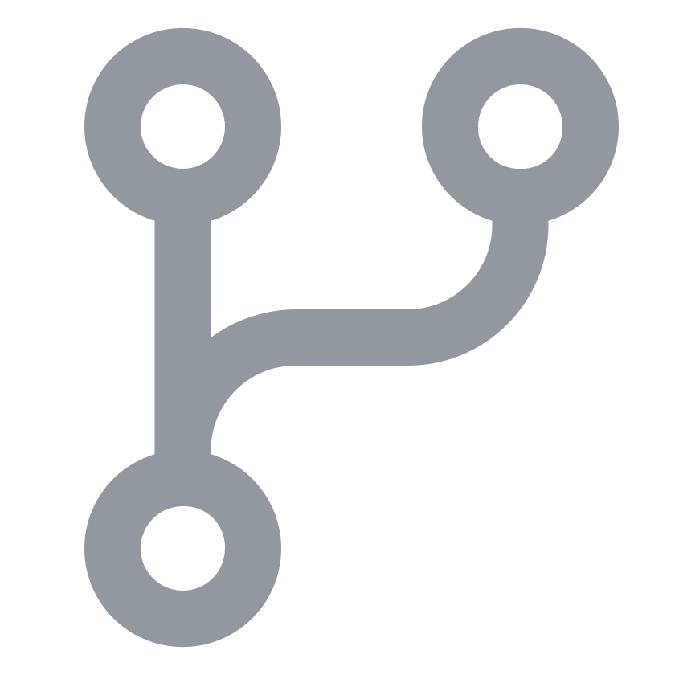
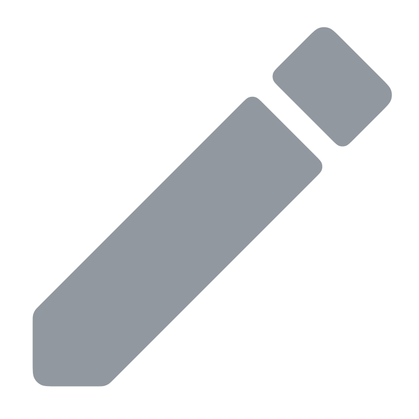

<p align="center">
  <a href="https://labs.koseka.net"></a>
  <p align="center">
    Contributions, corrections, and requests can be made through GitHub, and the documentation lives in the <a href="docs">docs</a> directory.
  </p>
  <p align="center">Thank you for your interest in the project, enjoy your reading! 🚀</p>
</p>

<div align="center">
  <a href="https://labs.koseka.net/phased-versioning"></a>
  <a href="LICENSE"></a>
  <br>
  <a href="https://github.com/KosekaLabs/kalium"></a>
  <a href="https://github.com/KosekaLabs/kalium/commits/dev"></a>
  <a href="https://github.com/KosekaLabs/kalium/milestones"></a>
  <a href="https://github.com/KosekaLabs/kalium/stargazers"></a>
</div>

---

Kalium is the kernel of [QualiaOS](https://github.com/KosekaLabs/qualia-os). It is written entirely in Rust, runs on bare metal on mobile SoCs, and executes exactly one kind of program: WebAssembly.

There is no native user space. Every service, every interpreter, every app above the kernel is a WebAssembly module, isolated by the Wasm sandbox and the MMU together, and authorized by capabilities rather than by user IDs. The kernel does not know what JavaScript, HTML, an app or a browser is; those are built out of WebAssembly modules that the OS ships next to it.

**What the kernel does:**

- Boots the SoC, sets up memory and the MMU, handles interrupts.
- Schedules WebAssembly instances, with a real-time class for the system agent and the audio pipeline.
- Runs WebAssembly: loads, validates, compiles or interprets, and executes modules with the sandbox guarantees the format promises.
- Mediates all access to hardware and to other instances through capabilities.
- Drives devices: display, touch, audio, storage, radios, and the NPU.

**What the kernel refuses to do:**

- Load or execute native code from user space.
- Carry a file system, network stack, window system or shell as kernel code where a WebAssembly service can do the job.
- Special-case any language, interpreter or application.

**Status.** The first prototype is complete: a `no_std` Rust kernel that boots on QEMU `virt` (aarch64) and runs WebAssembly services through its own spec-tested interpreter, with capabilities (including revocation), channels with capability transfer, memory objects, per-instance resource quotas, instance snapshots, a WASI preview1 layer for unmodified Rust `std` and C programs, and a two-class scheduler (real-time EDF plus weighted fair). Ahead-of-time compilation, MMU-backed instance memory, SMP and devices are future milestones. [docs/status.md](docs/status.md) has the details, the open decisions and what comes next.

<h2>&nbsp;&nbsp;Branches</h2>

| Branch | Description                                                       |
| :----- | :---------------------------------------------------------------- |
| `dev`  | The development branch. There is no stable generation (`v1`) yet. |

**Note for Contributors:** Please submit all feature requests and standard bug fixes to the **`dev`** branch.

<h2>&nbsp;&nbsp;Installation</h2>

Kalium is a kernel, not a library or a command-line tool, so it is built from a clone of the repository rather than installed. It needs:

- The Rust toolchain pinned in `rust-toolchain.toml` (stable, with the `aarch64-unknown-none`, `wasm32-unknown-unknown` and `wasm32-wasip1` targets, `rust-src` and `llvm-tools`). `rustup` installs it on the first `cargo` command in the repository. If you want to install Rust, follow the instructions on the [Rust website](https://www.rust-lang.org/tools/install/).
- `qemu-system-aarch64` to boot the kernel (tested with QEMU 8.2).
- Optionally clang and wasi-libc, to rebuild the C demo; without them the checked-in `demos/hello-c/prebuilt/hello_c.wasm` is used.

```sh
git clone https://github.com/KosekaLabs/kalium.git
cd kalium
cargo xtask test
```

<h2>&nbsp;&nbsp;Usage</h2>

Everything goes through `cargo xtask`:

```sh
cargo xtask wasm       # builds the SDK example services and the WASI demos into target/wasm/
cargo xtask build      # wasm, then the kernel for aarch64-unknown-none
cargo xtask run        # builds, then boots the kernel in QEMU on the terminal
cargo xtask test       # host tests, build, boot in QEMU and check the scenario
cargo xtask boot-test  # HAL-only boot: UART, MMU, timer ticks, exit
cargo xtask selftest   # HAL self-test: W^X faults, stack guard, FP state, device tree
cargo xtask clippy     # lints for the host crates, the kernel, the SDK and the demos
cargo xtask fmt-check  # formatting for the three workspaces
```

`cargo xtask test` boots the kernel and runs 13 WebAssembly services from the boot image, checking their output in order; the kernel exits QEMU with code 0 only if the whole scenario passes.

Services are written against the SDK in [sdk/](sdk/README.md). [docs/running.md](docs/running.md) has the QEMU command line, the expected output, how to write and add a service, and how to test hostile services.

| Document | What it covers |
| :-- | :-- |
| [docs/architecture.md](docs/architecture.md) | The long-term design: subsystems, the host ABI, security model, scheduling, memory, the NPU path. |
| [docs/prototype-plan.md](docs/prototype-plan.md) | The prototype's binding contract: host ABI tables, crate contracts, limits, definition of done. |
| [docs/running.md](docs/running.md) | Building, running and testing the prototype on QEMU; adding a service. |
| [docs/status.md](docs/status.md) | What runs, performance, bugs found and fixed, known limitations. |

<h2>&nbsp;&nbsp;Security</h2>

Vulnerabilities and sensitive information should not be reported via public GitHub issues. Please refer to the [Security Policy](SECURITY.md) for details on supported versions and instructions on how to responsibly disclose security concerns.

<h2>&nbsp;&nbsp;Contributing</h2>

This project is open to contributions and suggestions, and any help or feedback is highly appreciated. There is no code of conduct, but please be respectful and considerate when engaging with the community.

This project follows [Phased Versioning](https://labs.koseka.net/phased-versioning) for its versioning, branching, and release rules, and [Conventional Commits](https://www.conventionalcommits.org/en/v1.0.0/) for its commit messages. So, make sure to read both first before contributing to the project in any way. Additionally, please refer to the [Contribution Guide](CONTRIBUTING.md) for setup instructions and guidance on how to contribute the project.

Unless you explicitly state otherwise, any contribution intentionally submitted for inclusion in this project by you, shall be licensed as below, without any additional terms or conditions.

<h2>&nbsp;&nbsp;License</h2>

Copyright 2026 Amon Rayfa.

This project is licensed under the [Apache License (Version 2.0)](LICENSE). The Koseka and Koseka Labs names, the mark and the banner are brand assets of Koseka and are not covered by it — see the [NOTICE](NOTICE).
